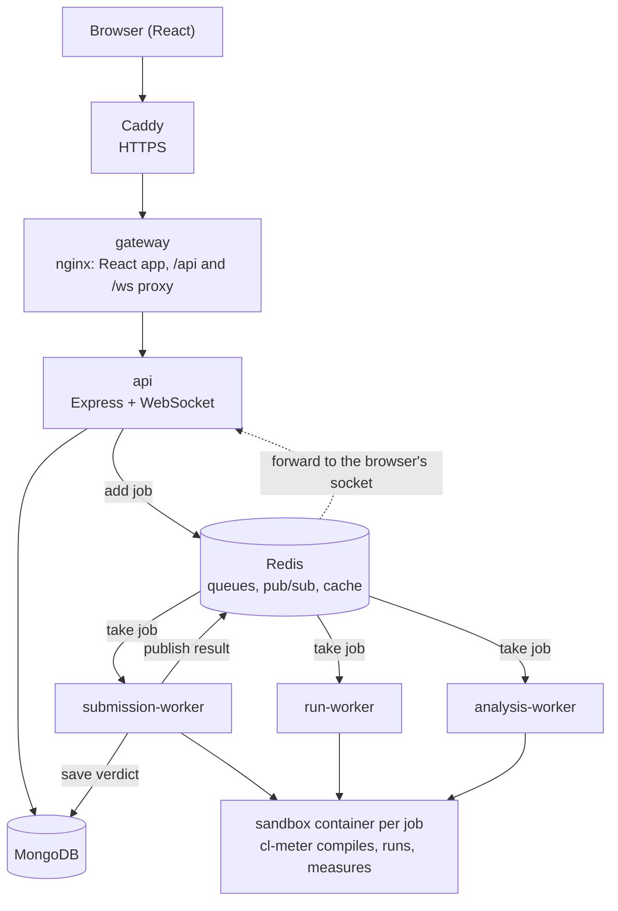

<div align="center">
  <br />
  <h1>CodeLeet</h1>
  <p><strong>An online coding platform and judge</strong></p>
  <p><a href="https://beta.codeleet.me">beta.codeleet.me</a></p>
</div>

<p align="center">
  <a href="#features">Features</a> •
  <a href="#architecture">Architecture</a> •
  <a href="#running-locally">Running locally</a> •
  <a href="#tests">Tests</a> •
  <a href="#scaling">Scaling</a> •
  <a href="#deployment">Deployment</a>
</p>

---

CodeLeet is a LeetCode-style platform: pick a problem, write a solution in the
browser, and get a verdict from a judge that runs your code in an isolated
Docker sandbox. Results stream back live over WebSockets, along with how the
run used time and memory. When a solution fails, the judge looks for a smaller
input that fails the same way; when it passes, it estimates its time
complexity.

The public beta runs at **https://beta.codeleet.me**.

## Features

- **C++ and Java** solutions, LeetCode style: you write `class Solution`, the
  platform supplies `main`, input parsing and output.
- **Run and Submit.** Run checks your code against the tests without saving;
  Submit judges it and saves the verdict to your history.
- **Verdicts:** Accepted, Wrong Answer, Runtime Error, Time Limit Exceeded,
  Memory Limit Exceeded and Compilation Error, with the failing test.
- **Resource timeline:** memory and CPU over time for the heaviest test, plus
  time and peak memory per test.
- **Smaller failing input:** after a wrong answer, crash or limit, the judge
  searches for a much smaller input that fails the same way and shows it with
  the expected and actual output.
- **Time complexity:** after Accepted, the solution is timed at growing input
  sizes and fitted to a class (O(n), O(n log n), ...) and compared with the
  intended one.
- **Live updates** over WebSockets: Running, the verdict, then the analysis
  results as they finish.
- **Accounts:** email and password, or Google sign-in. Dashboard with a
  12-week activity heatmap and recent submissions.
- **Problems** filtered by difficulty and topic, with search and a command
  palette (⌘K). Light and dark themes.

## Architecture



How a submission is judged:

1. `POST /api/submissions` saves the submission as `in_queue` and adds a job
   to the `submission-queue` (BullMQ on Redis). The API never runs user code.
2. A `submission-worker` takes the job and starts one sandbox container
   through the host's Docker. Inside it, **cl-meter** (`backend/docker/cl-meter.c`)
   compiles the code once, runs every test case, measures each run from
   `/proc` and enforces the time and memory limits per test.
3. The worker compares outputs outside the sandbox (expected outputs never
   enter it), saves the verdict to MongoDB and publishes it on Redis.
4. The API replica holding the browser's WebSocket forwards it. The latest
   message is also cached briefly in Redis, so a socket that connects late
   still gets it.
5. Follow-ups arrive on the same socket: the smaller failing input (after a
   failure), and the complexity estimate from the `analysis-worker` (after
   Accepted, on its own low-priority queue).

Run uses the same path with its own queue and worker, and saves nothing.

## Tech stack

- **Frontend:** React 19, Vite, Tailwind CSS 4, Monaco Editor, Framer Motion,
  React Router
- **Backend:** Node.js 22, Express 5, MongoDB with Mongoose, BullMQ and
  ioredis, `ws` for WebSockets, Passport (Google OAuth), JWT
- **Judge:** Docker sandboxes (GCC, Eclipse Temurin JDK 21) with `cl-meter`, a
  small C program that runs and measures each test
- **Infrastructure:** Docker Compose, nginx, Caddy, GitHub Actions, GitHub
  Container Registry

## Project structure

```
backend/
  app.js, server.js, wsServer.js   API: routes, health checks, WebSocket server
  controllers/, routes/, models/   HTTP handlers, Express routes, Mongoose models
  queue/                           BullMQ queues: submission, run, analysis
  worker/                          submission, run and analysis workers
  docker/                          judge.js, runCpp.js, runJava.js, cl-meter.c, sandbox Dockerfiles
  problemkit/                      problem packages: validation, code generation, seeding,
                                   smaller-input search, complexity fitting (see its README)
  tests/                           Jest tests
client/                            React app, nginx.conf for the gateway
deploy/                            Caddyfile, server setup and deploy scripts (see its README)
docker-compose.yml                 local stack
docker-compose.prod.yml            production overrides
```

## Running locally

You need **Docker** (Docker Desktop on Mac or Windows). Everything else runs in
containers.

```bash
# 1. Settings: set JWT_SECRET; Google sign-in is optional locally
cp .env.example .env
mkdir -p /tmp/codeleet-jobs

# 2. Sandbox images the workers start for each job
docker compose --profile sandbox build

# 3. Everything else: MongoDB, Redis, API, workers, gateway
docker compose up --build -d
```

Open **http://localhost:8080**. Stop with `docker compose stop`.

### Problems

Problems are built from problem packages: a folder per problem with the
statement, tests, a reference solution and an input generator. The seed
script checks each package, generates the large tests, runs the reference in
the sandbox to get their expected outputs, and writes the problems to MongoDB.
Packages hold hidden tests and reference solutions, so they are kept out of
this repository (`backend/problems/` is ignored). With packages in that
folder:

```bash
docker compose run --rm -v "$PWD/backend/problems:/app/problems:ro" \
  submission-worker npm run seed:problems
```

The package format and the seed options are described in
[`backend/problemkit/README.md`](backend/problemkit/README.md).

## Tests

```bash
cd backend && npm test    # Jest, with an in-memory MongoDB
cd client && npm test     # Vitest
```

CI (`.github/workflows/ci.yml`) runs both, builds every image and checks the
nginx config on each pull request and push to `main`.

## Scaling

With Docker Compose, every service scales by running more containers:

```bash
docker compose up -d --scale api=3 --scale submission-worker=2
```

- **API:** the gateway (`client/nginx.conf`) re-resolves `api` every 10
  seconds and sends each request to the replica with the fewest active
  connections. A WebSocket can land on any replica, since verdicts reach it
  through Redis pub/sub. `GET /api/health` names the replica that answered;
  `GET /api/ready` returns 503 until that replica reaches MongoDB and Redis,
  and the container healthcheck uses it.
- **Judging:** `WORKER_CONCURRENCY` (default 1) is how many jobs each
  submission or run worker handles at once. Every job starts a sandbox
  limited to one CPU, so keep (submission + run workers) ×
  `WORKER_CONCURRENCY`, plus the analysis worker, within the machine's cores.
  Past that, runs slow down and correct solutions start hitting the time
  limit.
- **Analysis:** keep one `analysis-worker`, so complexity timings don't
  compete with each other.

In production, set `API_REPLICAS`, `SUBMISSION_WORKER_REPLICAS`,
`RUN_WORKER_REPLICAS`, `WORKER_CONCURRENCY` and `ANALYSIS_WORKER_REPLICAS` in
`.env` (see `.env.prod.example`).

## Deployment

Production runs `docker-compose.yml` with `docker-compose.prod.yml` on one
Linux server: Caddy (automatic HTTPS), the gateway, the API, the workers and
Redis, with MongoDB on Atlas.

1. A push to `main` runs CI. When it passes, every image is built for amd64
   and arm64 and pushed to GHCR, tagged `latest` and with the commit SHA.
2. The deploy job waits for approval in the GitHub `production` environment,
   then copies the compose files to the server over SSH and runs
   `deploy/deploy.sh <sha>`: pin the tag, pull the images, restart what
   changed, wait for `/api/ready`, remove old images.
3. To roll back, run the Deploy workflow by hand with an earlier commit SHA.

`docker compose up -d` recreates containers, so the site is unavailable for a
few seconds during a deploy. Queued jobs stay in Redis, and workers finish
their current job before stopping.

Server setup, settings and secrets are in [`deploy/README.md`](deploy/README.md).

## Sandbox security

Each judging job runs in a fresh container that is removed afterwards:

- `--network none`: no network access.
- `--user nobody`, `--cap-drop ALL`, `--security-opt no-new-privileges`: an
  unprivileged user with no Linux capabilities.
- `--read-only`, with the job folder mounted read-only and a 64 MB `/tmp`
  for compiling and running.
- `--cpus 1`, `--memory 320m` with no swap, `--pids-limit 64`, and limits on
  open files and file size.
- cl-meter enforces the time limit and a 256 MB memory limit per test, and
  kills anything the program leaves running.
- Only test inputs are given to the sandbox; outputs are compared outside it.
  Hidden tests, drivers and reference solutions are never returned by the API.
