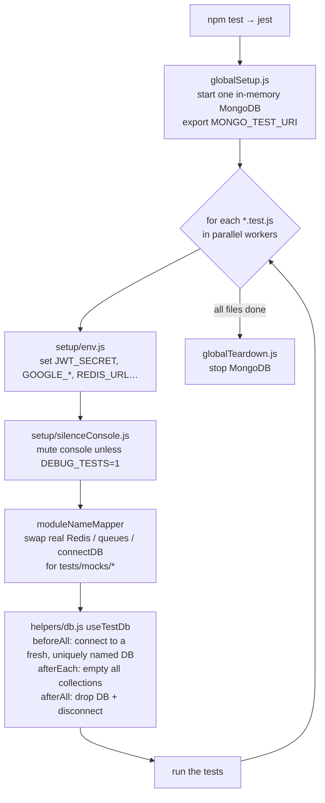
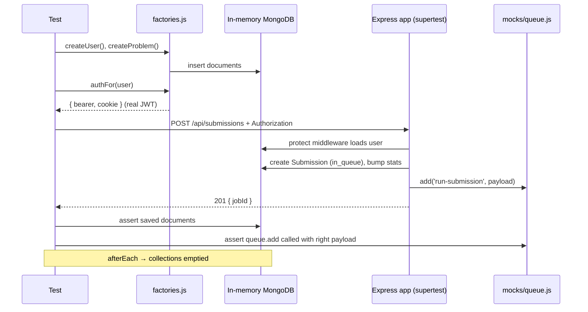
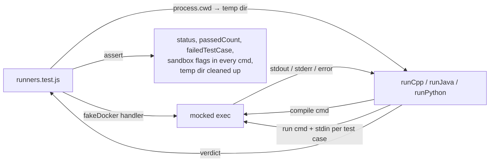
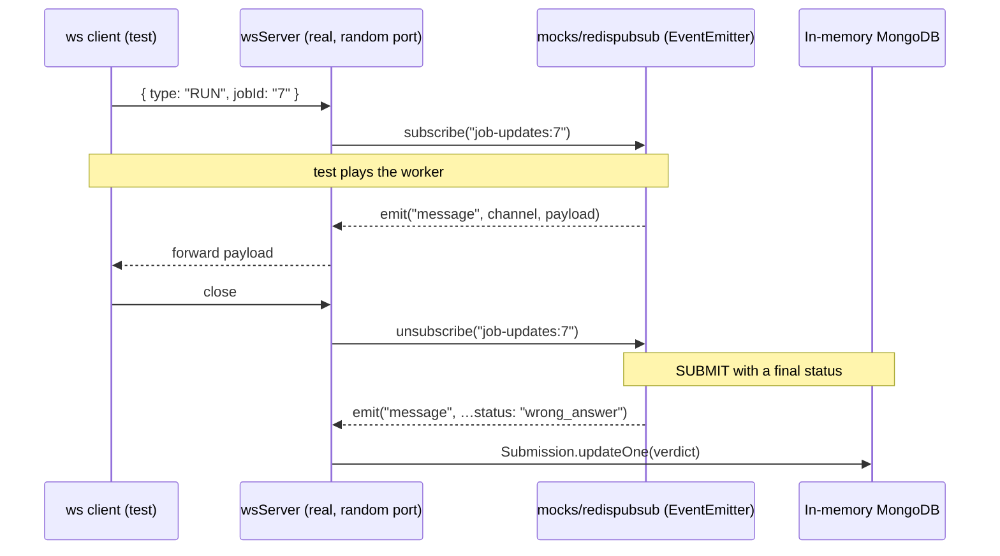
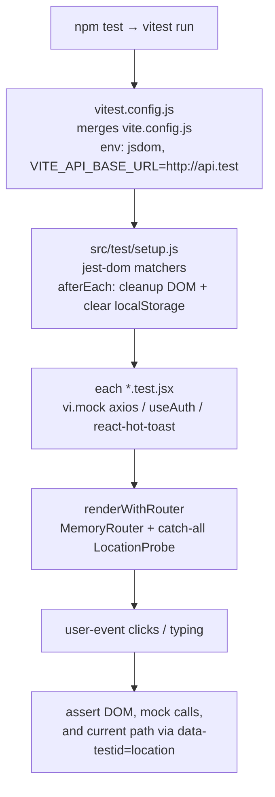

# Test Flow

How the CodeLeet test suites are wired together and what happens when you run them.

| | Backend | Client |
|---|---|---|
| Runner | Jest 29 | Vitest 3 |
| Location | `backend/tests/` | `client/src/**/*.test.jsx`, helpers in `client/src/test/` |
| Command | `cd backend && npm test` | `cd client && npm test` |
| Coverage | `npm run test:coverage` | `npm run test:coverage` |
| External services needed | None (MongoDB runs in memory) | None |

---

## Backend

### 1. What happens on `npm test`



### 2. Real vs fake

| Dependency | In tests | Where |
|---|---|---|
| MongoDB | **Real** MongoDB in memory (mongodb-memory-server) | `setup/globalSetup.js`, `helpers/db.js` |
| `config/db.js` (`connectDB`) | No-op; tests connect themselves | `mocks/db.js` |
| `config/redis.js` (cache) | `get` / `set` / `publish` as `jest.fn` | `mocks/redis.js` |
| `config/redispubsub.js` | `EventEmitter` with `subscribe` / `unsubscribe` as `jest.fn` | `mocks/redispubsub.js` |
| `queue/runQueue.js`, `queue/submissionQueue.js` | `add` as `jest.fn` returning `{ id }` | `mocks/queue.js` |
| `docker run` (via `child_process.exec`) | `jest.mock('child_process')` with a fake that answers per command | `unit/runners.test.js` |
| Express app + WebSocket server | **Real** | `app.js`, `wsServer.js` |

Mocks are wired globally in `jest.config.js` → `moduleNameMapper`, so any `require('../config/redis')` anywhere in the app gets the fake. `clearMocks: true` resets call history between tests.

### 3. Folder layout

```
backend/tests/
├── setup/          runs around every test file (env, console, Mongo lifecycle)
├── mocks/          stand-ins for Redis, BullMQ queues, connectDB
├── helpers/        db.js (useTestDb) and factories.js (createUser, createProblem, createSubmission, authFor)
├── unit/           pure logic: token, username, User model, code runners
├── api/            HTTP routes through supertest(app)
└── integration/    real WebSocket client ↔ wsServer ↔ fake Redis pub/sub
```

### 4. Flow of a typical API test



### 5. Flow of the code-runner tests



The fake decides the response from the command text (compile vs run) and the stdin (the test-case input), so the same runner code that runs in production is exercised end to end, minus Docker.

### 6. Flow of the WebSocket tests



---

## Client

### 1. What happens on `npm test`



### 2. Real vs fake

| Dependency | In tests |
|---|---|
| `src/api/axios.js` | `vi.mock` with `get` / `post` as `vi.fn` |
| `useAuth` from `AuthContext` | `vi.mock` returning `{ user, loading, setUser }` per test (except `AuthContext.test.jsx`, which tests the real provider) |
| `react-hot-toast` | `vi.mock` with `success` / `error` as `vi.fn` |
| React Router | **Real**, via `MemoryRouter` |
| Components, forms, framer-motion | **Real** |

### 3. How navigation is asserted

`renderWithRouter(ui, { route })` mounts the component at `route` plus a catch-all route rendering `<LocationProbe />`. When the component navigates away, the probe shows the new path:

```js
expect(screen.getByTestId('location')).toHaveTextContent('/dashboard')
```

---

## Known-bug tests (`it.failing`)

These tests describe the *correct* behaviour and are expected to fail today. Jest reports them as passing while the bug exists. Once the bug is fixed they start failing, as a reminder to change `it.failing` to `it`.

| Test | Bug |
|---|---|
| `api/submissions.test.js` → returns 404 for an unknown problem (submit) | `submissionController.js` reads `problem.codeTemplates` before the null check → 500 |
| `api/submissions.test.js` → returns 404 for an unknown problem (run) | Same in `runConroller.js` |
| `unit/runners.test.js` → runJavaScript exports a runner function | `docker/runJavaScript.js` is empty, so all JavaScript runs fail |

---

## Adding a new test

**Backend API route**
1. Create `backend/tests/api/<thing>.test.js`.
2. Call `useTestDb()` at the top.
3. Build data with `createUser` / `createProblem` / `createSubmission`; authenticate with `authFor(user).bearer`.
4. `await request(app).get(...).set('Authorization', bearer)` and assert on the response and the DB.

**Client component**
1. Create `<Component>.test.jsx` next to the component.
2. `vi.mock` axios / `useAuth` as needed.
3. Render with `renderWithRouter` if it uses the router; otherwise `render`.
4. Drive it with `userEvent`, assert with jest-dom matchers.

## CI notes

- Both suites: `npm ci && npm test`.
- First backend run downloads a MongoDB binary (~100 MB). Cache `~/.cache/mongodb-binaries`.
- `DEBUG_TESTS=1 npm test` in `backend/` shows app logs when debugging a failure.
